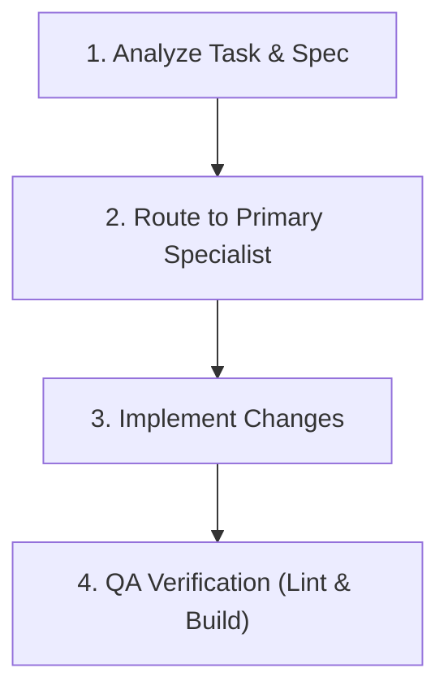

# 🤖 Multi-Agent Orchestration Guide

Central guide for specialized autonomous agents powering the **Akmalxanv Portfolio** (static Vite/React frontend on Vercel).

---

## 🎯 Delegation Matrix

| Request Type | Primary Specialist | Supporting Agent | Spec File |
| :--- | :--- | :--- | :--- |
| Vite config, Rollup chunks, package dependencies, app layout flow | **Build Architecture** | QA & Performance | [`agents/build-architecture.md`](agents/build-architecture.md) |
| React UI components, WebGL canvases, Framer Motion transitions | **Frontend UI** | Design & Translations | [`agents/frontend-ui.md`](agents/frontend-ui.md) |
| Tailwind tokens, global styles, EN/RU translations, image assets | **Design & Translations** | Frontend UI | [`agents/design-translations.md`](agents/design-translations.md) |
| Git hygiene, `.env` config, client form security, Vercel deployment | **Security & Deploy** | Build Architecture | [`agents/security-deploy.md`](agents/security-deploy.md) |
| ESLint checks, production builds, 60 FPS WebGL stability, a11y | **QA & Performance** | Frontend UI | [`agents/qa-performance.md`](agents/qa-performance.md) |

---

## 📂 File Ownership Map

```
portfolio/
├── AGENTS.md                          <-- Orchestrator & Build Architecture
├── .agents/                           <-- Orchestrator & All Agents
├── vite.config.js                     <-- Build Architecture
├── package.json / package-lock.json   <-- Build Architecture
├── index.html                         <-- Build Architecture
├── src/
│   ├── main.jsx                       <-- Build Architecture
│   ├── App.jsx                        <-- Build Architecture
│   ├── i18n.js                        <-- Build Architecture
│   ├── index.css / styles.js          <-- Design & Translations
│   ├── constants/index.js             <-- Design & Translations
│   ├── locales/{en,ru}/*.json         <-- Design & Translations
│   ├── assets/                        <-- Design & Translations
│   ├── components/
│   │   ├── *.jsx                      <-- Frontend UI
│   │   └── canvas/*.jsx               <-- Frontend UI
│   ├── hoc/*.jsx                      <-- Frontend UI
│   └── utils/motion.js                <-- Frontend UI
├── .env / .env.example / .gitignore   <-- Security & Deploy
└── .eslintrc.cjs                      <-- QA & Performance
```

---

## 🔄 Execution Workflow



1. **Analyze**: Check file ownership and choose primary specialist.
2. **Implement**: Fix root causes, preserve EN/RU parity, maintain static architecture.
3. **Verify**: Always run `npm run lint` and `npm run build`.

---

## 🤝 Cross-Agent Handoffs

- **Design & Translations ➔ Frontend UI**: Provide translation keys and static data arrays for JSX usage.
- **Frontend UI ➔ Design & Translations**: Request new copy, translations, or asset optimizations.
- **Frontend UI ➔ Security & Deploy**: Review client-side form submissions and env variable usage.
- **All Agents ➔ QA & Performance**: Verify lint standards, build success, and responsive stability.
