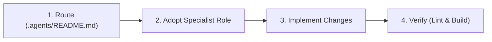

# 🤖 Autonomous Multi-Agent System

Orchestration rules for **Akmalxanv Portfolio** (static Vite/React single-page site on Vercel).

> **Directive**: Read [`.agents/README.md`](.agents/README.md) to select the specialist agent and enforce domain boundaries.

---

## 🧭 Specialist Agent Roster

| Specialist Agent | Spec File | Core Domain & Ownership | Key Triggers |
| :--- | :--- | :--- | :--- |
| **Build Architecture** | [`build-architecture.md`](.agents/agents/build-architecture.md) | `vite.config.js`, `package.json`, `index.html`, `src/App.jsx`, `src/i18n.js` | Bundler chunking, dependencies, static app flow, build setup |
| **Frontend UI** | [`frontend-ui.md`](.agents/agents/frontend-ui.md) | `src/components/`, `src/components/canvas/`, `src/hoc/`, `src/utils/motion.js` | React components, WebGL canvases, Framer Motion animations |
| **Design & Translations** | [`design-translations.md`](.agents/agents/design-translations.md) | `tailwind.config.js`, `src/index.css`, `src/styles.js`, `src/locales/`, `src/constants/`, `src/assets/` | Design tokens, EN/RU translation parity, static data, assets |
| **Security & Deploy** | [`security-deploy.md`](.agents/agents/security-deploy.md) | `.gitignore`, `.env*`, client sanitization in `Contact.jsx` | Client secrets, Git hygiene, Vercel static deployment |
| **QA & Performance** | [`qa-performance.md`](.agents/agents/qa-performance.md) | `.eslintrc.cjs`, bundle auditing, 60 FPS WebGL stability | Linting, build verification, responsive layout check, a11y |

---

## 🔄 Autonomous Execution Protocol

1. **Route**: Check [`.agents/README.md`](.agents/README.md) and identify the file owner.
2. **Adopt Role**: Follow domain constraints. Do not cross ownership boundaries without handoffs.
3. **Implement**: Preserve working features, responsive design, and EN/RU parity. Fix root causes.
4. **Verify**: Execute `npm run lint` and `npm run build` after changes.

---

## 🛡️ Core Rules

1. **Strict File Ownership**: Agents modify only their assigned files.
2. **Zero Hardcoded Strings**: All UI copy must reside in [`src/locales/en/translation.json`](src/locales/en/translation.json) and [`src/locales/ru/translation.json`](src/locales/ru/translation.json) with matching keys.
3. **Data Decoupling**: Static cards, links, skills, and projects reside in [`src/constants/index.js`](src/constants/index.js).
4. **Static Architecture**: Frontend-only static site; no server runtime or backend services.
5. **No Secrets in Source**: Keep sensitive tokens out of git; reference via `.env`.
